<p align="center">
  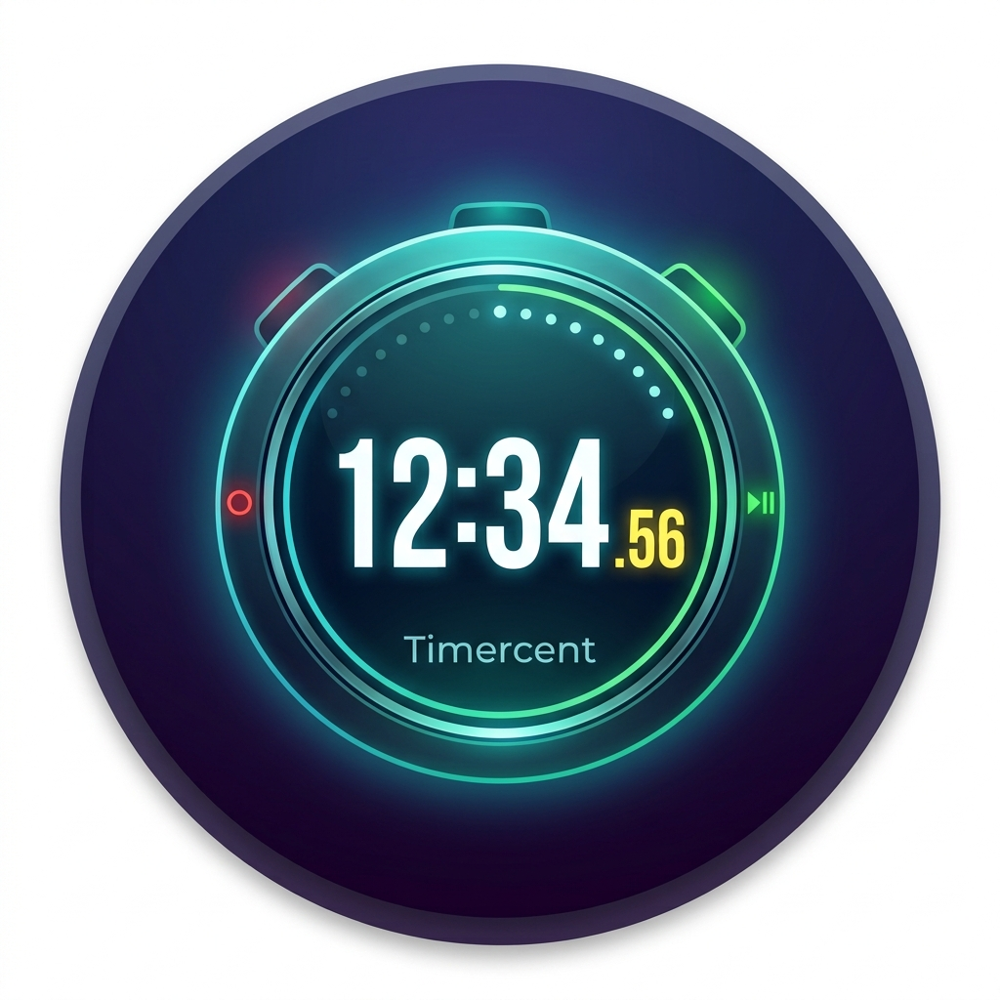
</p>

# Timercent

**English** · [Italiano](README.it.md)

Timer, stopwatch, world clock and alarms for Android, with tenths and hundredths of a second and fully customizable widgets.
No ads, no account, no internet connection.

<p align="center">
  <strong><a href="https://github.com/LucasSoftware3003/timercent/releases/latest/download/timercent-release.apk">⬇ Download the APK</a></strong>
  &nbsp;·&nbsp;
  <a href="https://github.com/LucasSoftware3003/timercent/releases/latest">Latest version and notes</a>
</p>

---

## Features at a glance

- **[Timer and stopwatch](#timer-and-stopwatch)**: multiple timers running in parallel, stopwatch with laps, precision in tenths, hundredths or thousandths.
- **[Widgets](#widgets)**: digital and analog widgets, highly customizable for each instance.
- **[Alarm groups](#alarm-groups)**: gather alarms into groups («Work», «Weekend») and manage them together: turn them all on or off at once, skip the next ring, apply a change to all of them.
- **[Alarms](#alarms)**: days, sound, vibration, snooze, automatic silence, rising volume and the «next alarm» notification.
- **[World clock](#world-clock)**: times and time zones of cities all over the world.
- **[Smartwatch control](#smartwatch-control)**: stop or snooze alarms and timers from your wrist.
- **[Android integration](#android-integration)**: works with voice assistants and other apps.

## Screenshots

### Widget examples

<p align="center">
  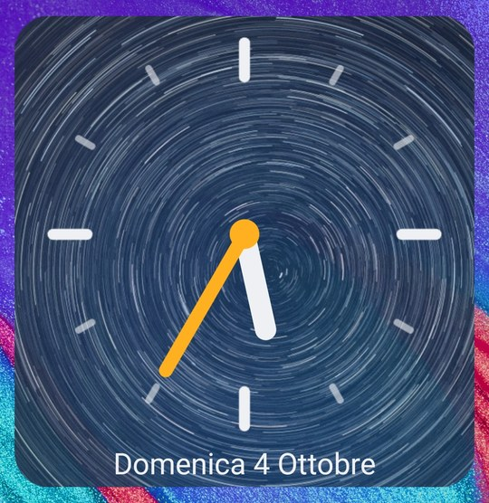
  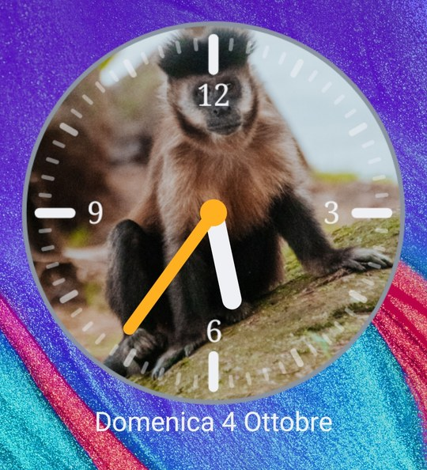
</p>
<p align="center">
  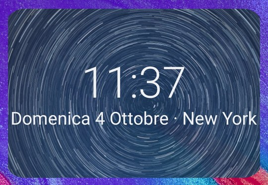
  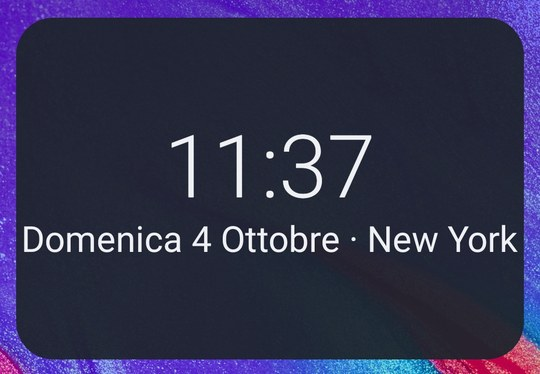
  
</p>

### App

<p align="center">
  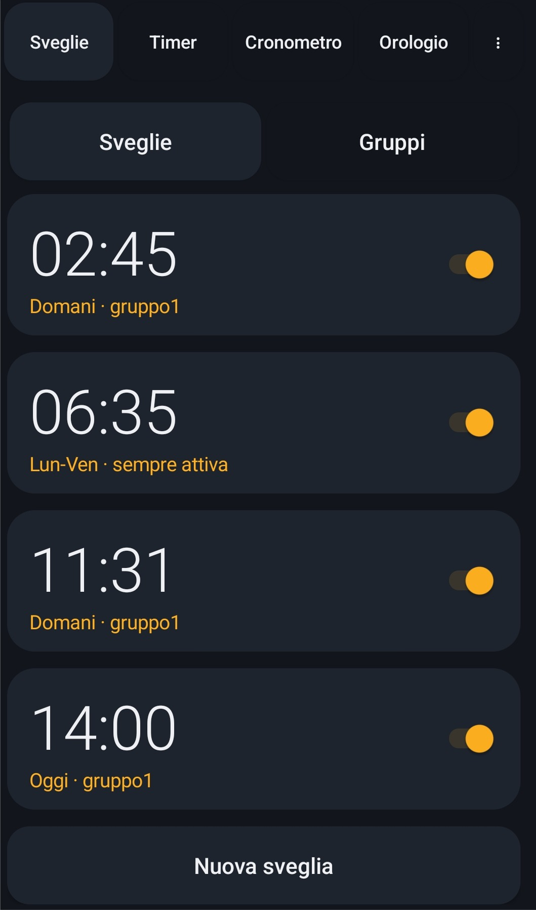
  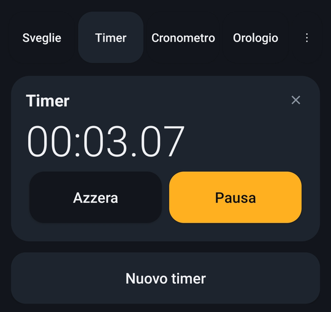
  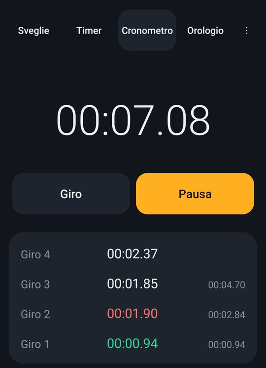
  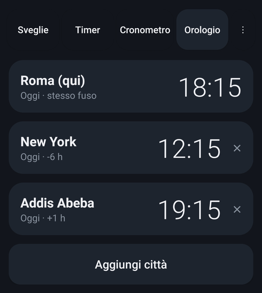
</p>

### Groups and smartwatch

<p align="center">
  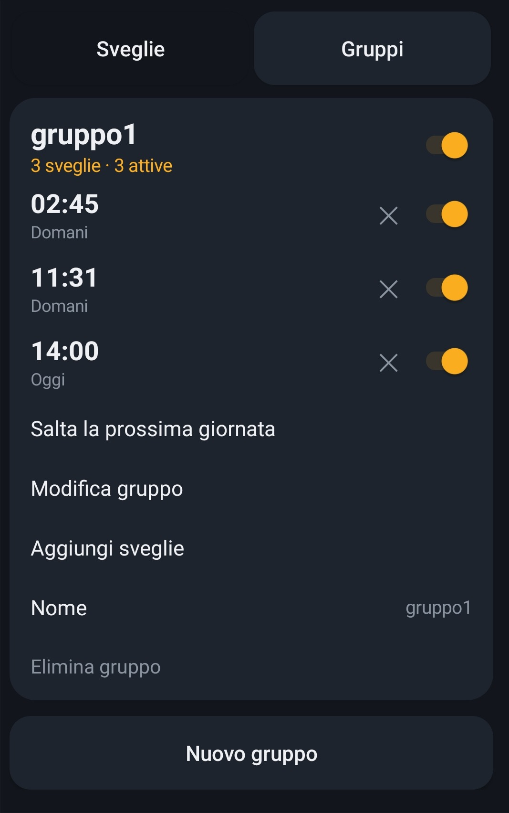
  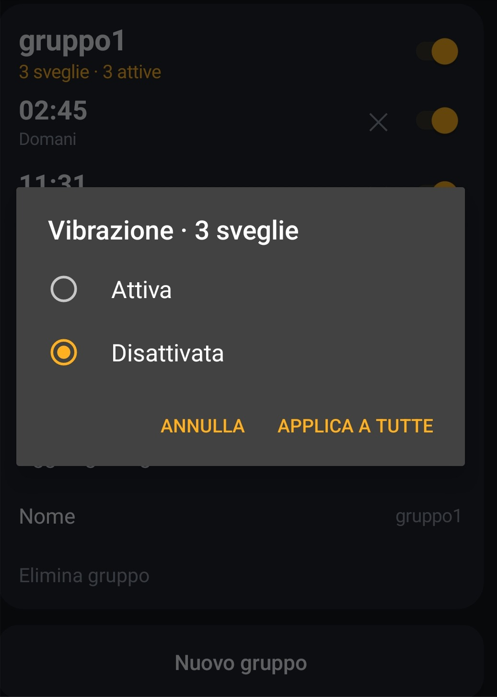
  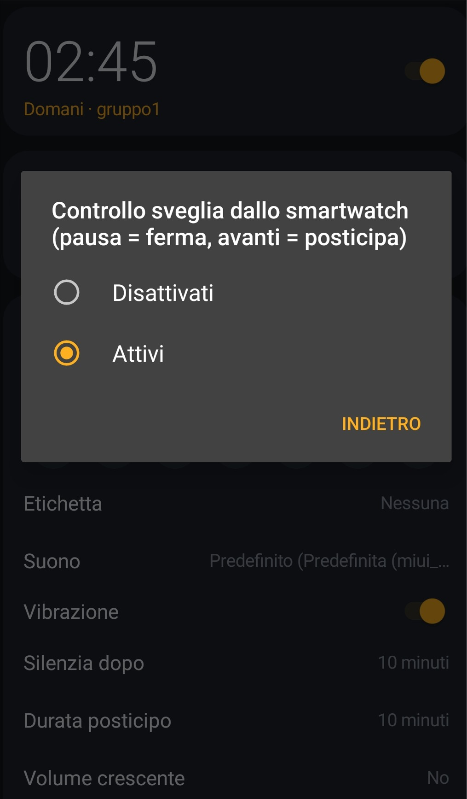
</p>

### Customization

<p align="center">
  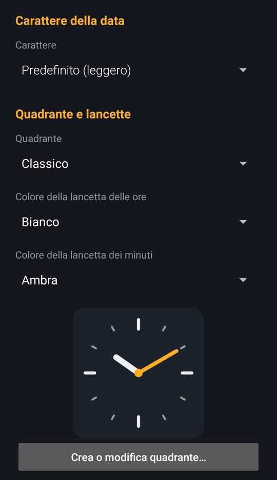
  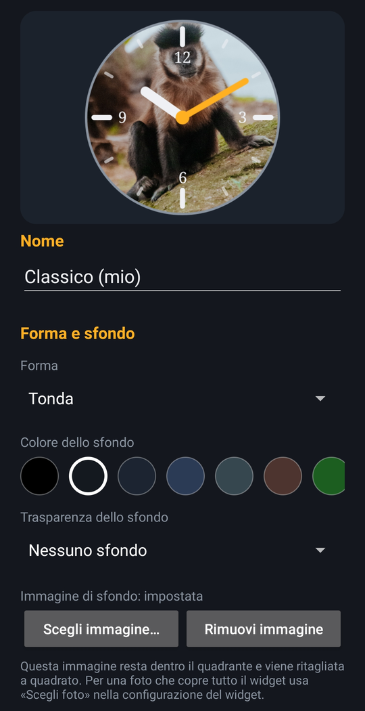
</p>

## Features in detail

### Timer and stopwatch

- **Multiple timers** in parallel, each with its own label (**tap it to edit**), sorted by increasing duration, and a choice of timer sound.
- When a timer ends you can **stop it** or add **+1 minute**, from the tab or from the notification.
- **Adjustable precision**: tenths, hundredths or thousandths of a second.
- **Stopwatch** with the same precision and **laps**: time of each lap and total time, with the best lap in green and the worst in red.
- Notifications and ringing even with the screen off.

### Interface

- Fixed dark theme, the same on all phones.
- Switch between tabs by **swiping** left and right.
- From the ⋮ menu → *About and donations*: version and build, license and **Check for updates**.

### World clock

- Times and time zones of cities all over the world, in a single tab.

### Alarms

- Days of the week, label, sound, vibration and the «delete after ringing» option.
- Snooze, automatic silence, rising volume and the behaviour of the volume keys.
- First day of the week and alarm volume can be set.
- Full-screen screen when the alarm rings, and automatic rescheduling after the phone restarts, for alarms and timers.
- **«Next alarm» notification** with a countdown and a **Skip** button (appears 15 minutes to 3 hours before, your choice, or never).
- **Always on**: an alarm with this option is not affected by group commands (see below).

### Alarm groups

In the Alarms tab, next to the list, there is the **Groups** page: it collects several alarms (for example «Work» or «Weekend») and gives them shared commands.

- **Group switch**: turns all alarms in the group on or off at once. Afterwards, each alarm is free to turn on and off by itself.
- **Skip the next day**: skips the next ring of all active alarms in the group, like the *Skip* button in the notification.
- **Apply to all**: changes one feature at a time across the group (days, sound, vibration, silence after, snooze length, rising volume, warning before the alarm), leaving everything else unchanged.
- An alarm can belong to **at most one group**; «always on» alarms cannot be part of one.
- When you delete a group, you choose whether to keep its alarms or delete them together with it.

### Smartwatch control

With the option **Smartwatch control for alarms and timers** (⋮ menu → *Alarm settings*, off by default), the ringing alarm or timer can be controlled from your wrist:

- **Pause** or **stop** stop the alarm or timer; **next track** snoozes the alarm or adds **+1 minute** to the timer.
- Works with watches that show the phone's music controls (for example Amazfit/Zepp).
- On Wear OS watches, the **Dismiss** and **Snooze** buttons (**+1 min** for timers) of the notification appear.

### Widgets

Two widgets, both customizable for each instance:

- **Digital**: 8 characters to choose from.
- **Analog**: 7 predefined dials plus a **dial builder** (shape, background, photo, numbers, also with an imported `.ttf` font, ticks), and hour and minute hands with a colour chosen separately from 12 options.
- Widget background photo with darkening and fit options (*resize* or *centre and crop*).
- Date, and a city or time zone different from the phone's.
- **On tap**, the widget opens the tab you choose: Alarms, Timer, Stopwatch or World clock.
- Text and dial colours with a palette picker or an exact hex code.

### Android integration

Timercent responds to the standard system requests, so it works with voice assistants and other apps:

| Request                       | Effect                                              |
| ----------------------------- | --------------------------------------------------- |
| `SET_ALARM` with a time       | creates the alarm (or reuses an identical one)      |
| `SET_TIMER` with a duration   | creates the timer and starts it                     |
| `SHOW_ALARMS`, `SHOW_TIMERS`  | open the corresponding tab                          |

To use it with the assistant, choose Timercent as the default app for alarms and timers the first time you give a command.

## Installation

1. Open the [**Releases**](https://github.com/LucasSoftware3003/timercent/releases) page and download the latest `.apk` file.
2. Open it on your phone and allow installation from this source when Android asks.
3. On first launch, grant the notification permission so timers and alarms can alert you.

Requirements: **Android 8.0 (API 26) or higher**.

The app is not distributed on Google Play. Since it is installed outside the store, some Android devices may show warnings or ask for extra confirmations.

For example, **Google Play Protect** may block the installation, because it has never seen apps from this developer. This does not mean the app is dangerous: the code is public in this repository. To continue, tap *More details* and then **Install anyway**.

<p align="center">
  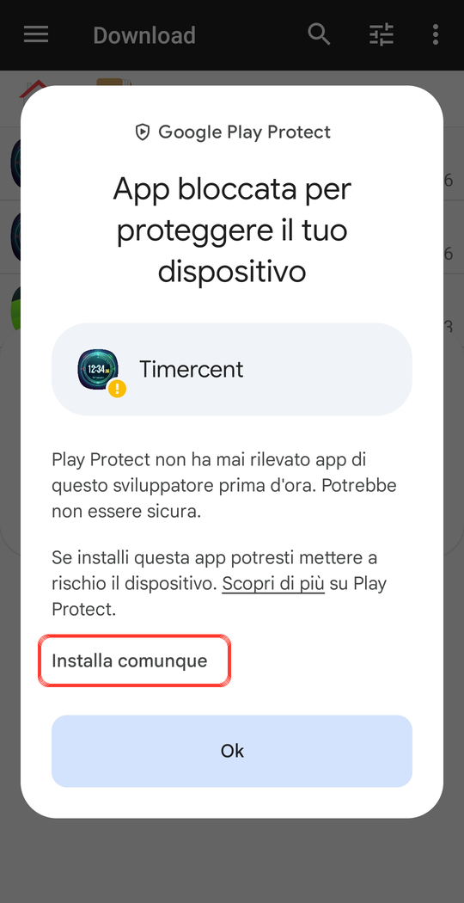
</p>

### Updates

The app does not check for updates by itself, because it has no internet access. To check whether a new version is out, open the ⋮ menu → *About and donations* → **Check for updates**: the Releases page opens in your browser. The app's version and build number are shown on the same screen («Version 1.23 · build N»).

## Privacy

- The app **does not request internet access**: it cannot send or receive any data.
- Timers, alarms, settings, photos and dial fonts stay **only on the phone**, unless you turn on Google backup (off by default, in the ⋮ menu → *Options* → *Google backup*).
- No ads, no tracking, no account.
- «Check for updates» only opens a web page in the browser: the connection is made by the browser, not by the app.

Permissions requested, and why:

| Permission                                   | Reason                                                        |
| -------------------------------------------- | ------------------------------------------------------------- |
| Notifications                                | timer and alarm alerts                                        |
| Exact alarms and reminders                   | make timers and alarms ring at the exact time                 |
| Full-screen notifications                    | show the alarm over the lock screen                           |
| Foreground service (audio playback)          | play timer and alarm sounds                                   |
| Vibration                                    | vibrate for timers and alarms                                 |
| Start after reboot                           | reschedule alarms and timers when the phone turns back on     |

## Building from source

Requirements: JDK 17 and Gradle 8.9 (or Android Studio).

```
git clone https://github.com/LucasSoftware3003/timercent.git
cd timercent
gradle assembleDebug
```

The debug APK is in `app/build/outputs/apk/debug/`.

### Automatic build on GitHub Actions

Every push to the `main` branch runs the [`apk.yml`](.github/workflows/apk.yml) workflow, which builds a **signed release APK** and publishes it in the Releases section, with a title in the format «Timercent 1.23 (build 20)»: the version is `versionName` in `app/build.gradle.kts`, and the build number is the workflow run counter. Changes that only touch `.md` files (such as the READMEs), `LICENSE` or the `docs/` folder do not start a build. If you fork the project, set these *secrets* in the repository to get a signed APK:

`KEYSTORE_BASE64`, `KEYSTORE_PASSWORD`, `KEY_ALIAS`, `KEY_PASSWORD`

## Project structure

| File                                      | Contents                                                                    |
| ----------------------------------------- | --------------------------------------------------------------------------- |
| `MainActivity.kt`                         | Timer, Stopwatch (with laps), World clock tabs, swiping and intents         |
| `Alarms.kt`, `AlarmsUi.kt`                | alarms: scheduling, ringing, smartwatch control, «next alarm» notification, UI |
| `Groups.kt`                               | alarm groups (data); the Groups page is in `AlarmsUi.kt`                    |
| `Notif.kt`                                | channels and notifications                                                  |
| `Widgets.kt`, `CfgBase.kt`                | digital and analog widgets, configuration screens                           |
| `Dials.kt`, `DialBuilder.kt`, `AnaRes.kt` | analog dials and the dial builder                                           |
| `ZonePick.kt`                             | city and time zone selection                                                |
| `About.kt`                                | About and donations screen                                                  |
| `docs/`                                   | screenshots used in this README                                             |

Package: `it.timercent`. Language: Kotlin, only Android APIs: no external libraries.

## Support the development

Timercent is free and ad-free. If you find it useful, you can buy me a coffee with an optional, free donation:

[**paypal.me/LucasSoftware3003**](https://paypal.me/LucasSoftware3003)

The same option is in the app, in the ⋮ menu → *About and donations*.

## License

Timercent is free software, released under the **GNU GPLv3** license.

- You can use, study and modify it freely.
- If you distribute a modified version (even for free), you must release it under GPLv3 and make the source code public.
- You cannot make it closed software or sell it without providing the code.
- No warranty: the program is provided «as is».

Full text: [LICENSE](LICENSE) · <https://www.gnu.org/licenses/gpl-3.0.html>

Copyright (C) 2026 Luca Serenelli (Lucas3003)

## Author

**Luca Serenelli** aka **Lucas3003**
